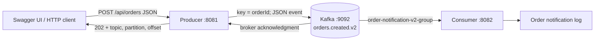

# Kafka Order Microservices

Two independent Java services demonstrate a validated HTTP order request becoming a structured Kafka event and a consumer notification. Objectives include asynchronous publishing, independent service deployment, a JSON contract, keyed ordering, acknowledgments, consumer groups, validation, recovery, and automated testing.

## Architecture



A 202 response confirms the broker acknowledged the event. Consumer processing happens independently; 202 does not confirm a notification was processed. There is no order database or actual email provider in this assignment.

## Technology stack

- Java 21, Maven (independent POMs and Maven wrappers).
- Spring Boot 4.1.2 and its managed Spring Kafka 4.1.2 / Kafka client 4.2.2 dependencies.
- Apache Kafka **broker** 4.1.2 in Docker, using KRaft (no ZooKeeper).
- Spring Web MVC, Actuator, Jakarta Bean Validation (producer).
- springdoc-openapi 3.2.0 and Swagger UI (producer).
- Jackson 3 via Spring Kafka's `JacksonJsonSerializer` and `JacksonJsonDeserializer`.
- JUnit, Mockito, MockMvc and Spring Boot test support.

The broker and client have different version numbers by design: the client version comes from Spring Boot dependency management. Avoid independently downgrading Kafka or replacing these serializers with deprecated Jackson 2 APIs. References: [Spring Kafka JSON serialization](https://docs.spring.io/spring-kafka/reference/kafka/serdes.html), [springdoc compatibility](https://springdoc.org/#what-is-the-compatibility-matrix-of-springdoc-openapi-with-spring-boot).

## Project structure

```text
KafkaMicroservices/
  compose.yaml
  README.md
  .gitignore
  producer-service/
    pom.xml, mvnw, mvnw.cmd
    src/main/java/com/henry/producerservice/
      ProducerServiceApplication.java
      controller/OrderController.java
      controller/GlobalExceptionHandler.java
      event/OrderCreatedEvent.java
      service/OrderProducerService.java
      service/OrderPublicationException.java
    src/main/resources/application.yaml
    src/test/java/com/henry/producerservice/...
  consumer-service/
    pom.xml, mvnw, mvnw.cmd
    src/main/java/com/henry/consumer/
      ConsumerServiceApplication.java
      config/KafkaConsumerConfiguration.java
      event/OrderCreatedEvent.java
      service/OrderConsumerService.java
    src/main/resources/application.yaml
    src/test/java/com/henry/consumer/...
```

Each public class lives in its matching file. Both services own their event record; their Java package names differ, but their JSON fields match. No shared Java library is needed. Type headers are disabled on publication and ignored during consumption; the consumer explicitly chooses its own record type.

## Prerequisites and Docker

Run commands from the root in PowerShell:

```powershell
Set-Location 'C:\Users\egede\OneDrive\Desktop\KafkaMicroservices'
java -version
docker compose ps
docker compose start kafka
```

For a **new installation only**, create the broker with `docker compose up -d kafka`. The existing Compose file binds `127.0.0.1:9092`; the verified broker advertises `localhost:9092`, which is correct for services running on the host.

Inspect topics and group progress:

```powershell
docker compose exec kafka /opt/kafka/bin/kafka-topics.sh --bootstrap-server localhost:9092 --list
docker compose exec kafka /opt/kafka/bin/kafka-topics.sh --bootstrap-server localhost:9092 --describe --topic orders.created.v2
docker compose exec kafka /opt/kafka/bin/kafka-consumer-groups.sh --bootstrap-server localhost:9092 --describe --group order-notification-v2-group
```

Only on a fresh broker where the JSON topic is missing:

```powershell
docker compose exec kafka /opt/kafka/bin/kafka-topics.sh --bootstrap-server localhost:9092 --create --if-not-exists --topic orders.created.v2 --partitions 1 --replication-factor 1
```

Preserve the existing container and volumes. Use `docker compose stop kafka` and `docker compose start kafka` to stop/start without replacing it. The image currently uses anonymous volumes, so recreating containers can detach existing data. Do not run `down -v`, remove volumes/topics, or reset offsets. The original `orders.created` plain-text topic is left intact; JSON consumers subscribe only to `orders.created.v2`.

## Build and run

Build each service (there is no root aggregator POM):

```powershell
.\producer-service\mvnw.cmd -f producer-service/pom.xml verify
.\consumer-service\mvnw.cmd -f consumer-service/pom.xml verify
```

In IntelliJ, reload both Maven projects after dependency changes. Run `ProducerServiceApplication` and `ConsumerServiceApplication` using Java 21. Stop older instances first if ports are occupied.

Alternatively run these in two separate PowerShell terminals from the root:

```powershell
java -jar producer-service/target/producer-service-0.0.1-SNAPSHOT.jar
```

```powershell
java -jar consumer-service/target/consumer-service-0.0.1-SNAPSHOT.jar
```

The consumer can start independently, including before the producer. Kafka must be available for message delivery; if unavailable the listener reconnects. Actuator HTTP liveness alone does not prove a Kafka connection.

- Producer health: http://localhost:8081/actuator/health
- Consumer health: http://localhost:8082/actuator/health
- Swagger UI: http://localhost:8081/swagger-ui/index.html
- OpenAPI JSON: http://localhost:8081/v3/api-docs

## Demonstration request

In Swagger select `POST /api/orders`, click **Try it out**, paste the JSON, and click **Execute**:

```json
{
  "orderId": "ORD-9010",
  "customerId": "CUST-101",
  "product": "Laptop",
  "quantity": 2,
  "status": "CREATED"
}
```

Equivalent PowerShell:

```powershell
$body = @{
    orderId = 'ORD-9010'
    customerId = 'CUST-101'
    product = 'Laptop'
    quantity = 2
    status = 'CREATED'
} | ConvertTo-Json
Invoke-WebRequest -Uri 'http://localhost:8081/api/orders' -Method Post -ContentType 'application/json' -Body $body -UseBasicParsing |
    Select-Object StatusCode, Content
```

Expected HTTP 202, for example (offset varies):

```json
{"orderId":"ORD-9010","status":"PUBLISHED","topic":"orders.created.v2","partition":0,"offset":7}
```

The producer logs `Kafka acknowledged orderId=ORD-9010 topic=orders.created.v2 partition=0 offset=...`.
The consumer Run console logs:
```text
Order notification processed successfully: orderId=ORD-9010 customerId=CUST-101 product=Laptop quantity=2 status=CREATED
```

Use the **ConsumerServiceApplication** Run tab in IntelliJ and search for the order ID. If running a JAR and saving logs, start it with `--logging.file.name=consumer-service/target/demo-consumer.log`, then monitor:

```powershell
Get-Content consumer-service/target/demo-consumer.log -Tail 30 -Wait
```

Group lag should eventually be zero after successful consumption. Reusing an order ID sends another event; this demo has no application-level deduplication.

## Validation and error handling

The producer uses constructor injection, `@Valid`, `@NotBlank`, `@NotNull`, `@Positive`, and an exact `CREATED` status constraint. Quantity must be present and positive. Invalid requests never reach the Kafka service.

| Outcome | HTTP response |
| --- | --- |
| Kafka acknowledges publication | 202 JSON acknowledgment |
| Missing/blank fields, nonpositive quantity, invalid status | 400 Problem Detail with field errors |
| Malformed JSON | 400 Problem Detail |
| Unsupported content type | 415 Problem Detail |
| Kafka send/acknowledgment failure | 503 Problem Detail |
| Unexpected application failure | 500 Problem Detail |

The global handler uses Spring's `ProblemDetail` responses and avoids exposing internal exception details. Producer sends return a `CompletableFuture`; no blocking `get()` or `join()` is used in request handling. Kafka metadata acquisition can block up to 5 seconds; delivery is bounded to 10 seconds and the MVC async timeout is 20 seconds. The producer requests `acks=all` and enables Kafka producer idempotence. A 503 can have an ambiguous delivery outcome, so verify before retrying; idempotence does not deduplicate separate HTTP requests.

The consumer wraps Jackson JSON deserialization in `ErrorHandlingDeserializer` so malformed records reach the container error handler. Valid JSON is also checked for required business values before logging success. Transient listener failures get two retries with one-second backoff. Invalid events and deserialization failures are nonretryable. After recovery, the failed record location and exception are logged and consumption continues; record acknowledgment mode and disabled auto-commit let the container manage offsets.

**Recovery policy:** exhausted/invalid records are skipped after logging. There is no dead-letter topic or durable failed-record archive in this assignment. The original record remains in the source topic until Kafka retention removes it, but this consumer group advances past it. For production, add a dead-letter topic and idempotent business processing.

## Automated tests

```powershell
.\producer-service\mvnw.cmd -f producer-service/pom.xml verify
.\consumer-service\mvnw.cmd -f consumer-service/pom.xml verify
```

A locally installed Maven can replace the wrapper, e.g. `mvn -f producer-service/pom.xml verify`.

Tests use mock Kafka templates/consumers and disable listener startup in context tests. No live broker is required. They cover API success, waiting for acknowledgment, invalid/missing input, malformed JSON, 415/500/503 handling, correct topic/key, synchronous/asynchronous publishing failures, consumer field logging and validation, Jackson 3 deserialization, malformed-record capture, retry exhaustion, and nonretryable recovery.

Surefire reports are written to each service's `target/surefire-reports`. Live end-to-end testing is a separate check using the demonstration above. See [verification results](VERIFICATION.md) for actual executed results and limitations.

## Kafka concepts demonstrated

- **Topic:** a durable named event stream; v2 separates JSON from older text messages.
- **Producer and broker acknowledgment:** successful send confirms Kafka stored the record under the configured acknowledgment policy.
- **Key and partition:** order ID is the key; records with the same key go to the same partition under stable partitioning.
- **Offset:** record position within a partition, included in the publication response.
- **Consumer group:** `order-notification-v2-group` tracks its progress and shares partitions between group members.
- **Offset reset:** `earliest` applies only when the group has no valid committed offset; normal restarts resume from commits.
- **Delivery:** processing is at least once; failures/restarts can cause duplicates.
- **Single broker:** replication factor 1 suits a local demonstration but does not survive broker/data loss.
- **Loose coupling:** producer and consumer communicate through a JSON event contract and can run separately.

## Git and excluded files

Inspection found no Git repository at the root or inside either service. A root `.gitignore` excludes Maven outputs, IntelliJ/VS Code metadata, logs, environment files and common secret files. Existing service ignore files are preserved. No repository, commit, push, or GitHub project is created by this work. Review the source and documentation, then initialize/version the root only when ready and authorized.
